# Burning Calendar

**A harmonized MODIS + VIIRS burning-activity calendar** for NASA Space Apps 2026
(*Harmonization of MODIS and VIIRS Hot Spots*). Two decades of satellite fire hotspots, put on one scale,
so that the sensor of origin stops mattering and the seasons, anomalies and trends are what you see.
The website is also the presentation.

> **Live site:** https://1am6ada.github.io/NASA-Challenge-2026/  ·  **Demo video:** [docs/demo.mp4](docs/demo.mp4)
> (the hotspot-CSV download needs the local server, see [Run it](#run-it))


## What it does

| Challenge asks for | Where it is |
|---|---|
| Harmonize MODIS and VIIRS into one consistent series | `pipeline/04_calibrate.py`, `05_harmonize.py`; explained on the **Story** page |
| Calendar of hotspot counts from the early 2000s to now | Burning calendar (months x years) in the Explorer, Nov 2000 - Nov 2026 |
| Select a region and date range | Draw a **box** or **shape**, pick a **country**, step or play through months, choose month/year/all for downloads |
| Compare the current month with the historical median | Headline card ("19% below a normal November so far"), **Vs normal** map and calendar, Season chart |
| Colour ramps for similarities and differences | Sequential ramp for counts, diverging ramp for anomalies, colour-blind-safe, light and dark theme |
| Downloadable CSV of hotspots | **Data** tab: raw hotspots in the selected area (CSV), plus the monthly series (CSV) |
| Accessible, interactive | Keyboard (arrows, space), ARIA labels, table view of the calendar, works at phone width |

### Story page: why the records cannot be compared, and how they are
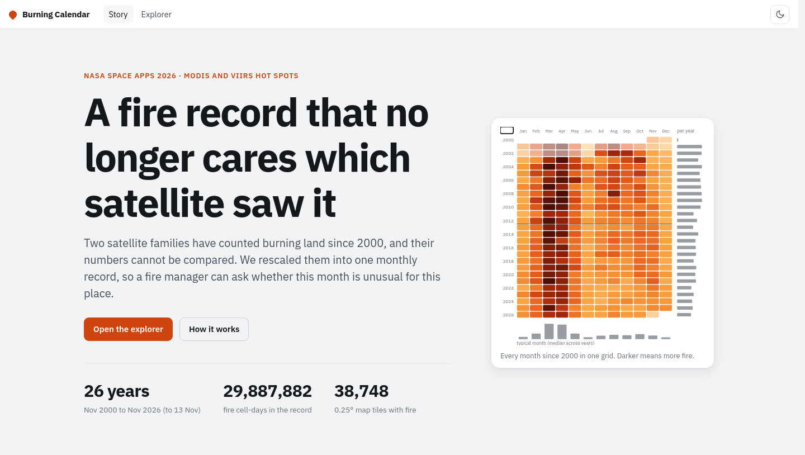
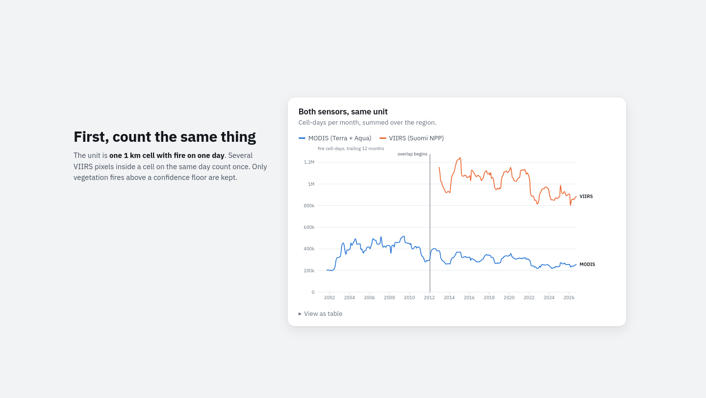
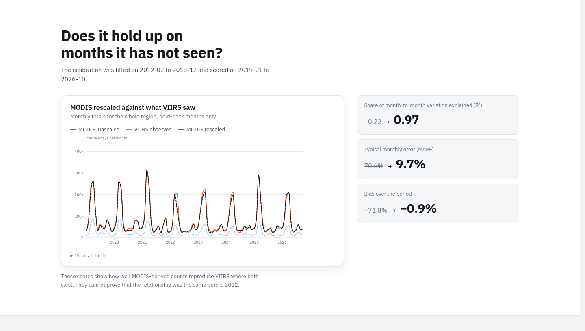
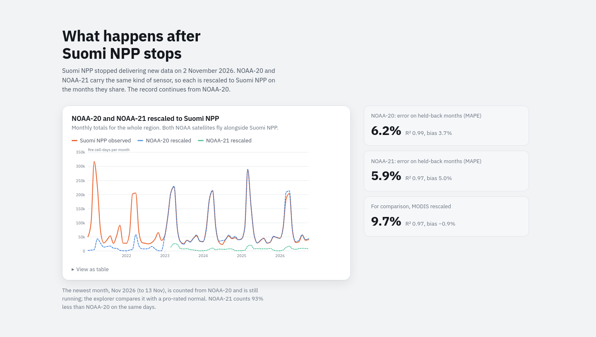

### Explorer: map, calendar, season, compare, download
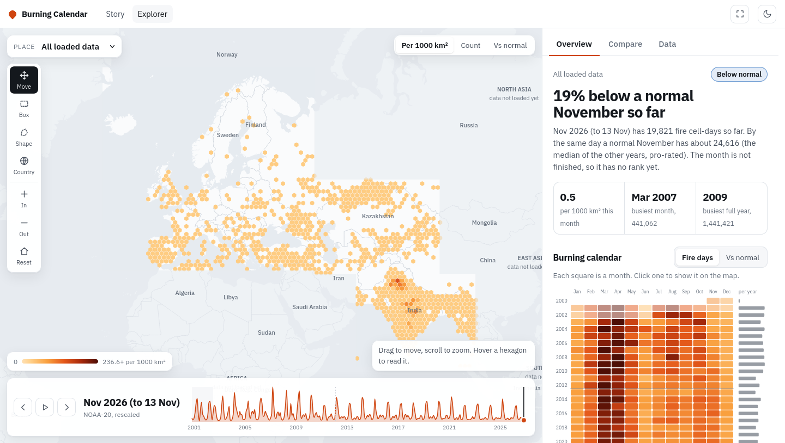

| Country (India: Punjab residue burning, Oct-Nov) | Custom drawn area |
|---|---|
| 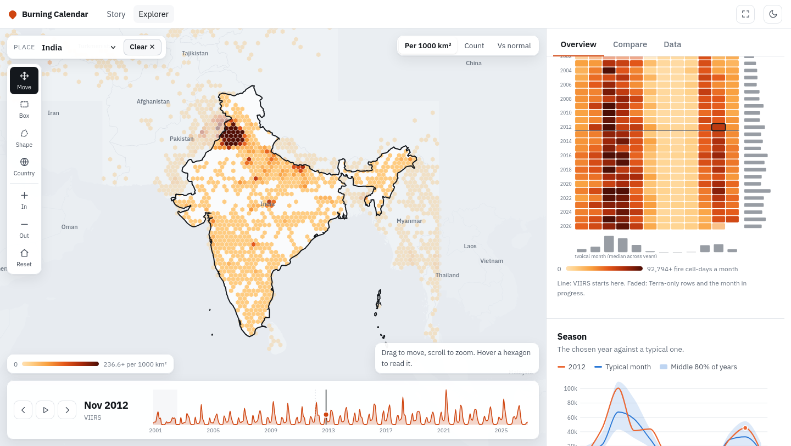 | 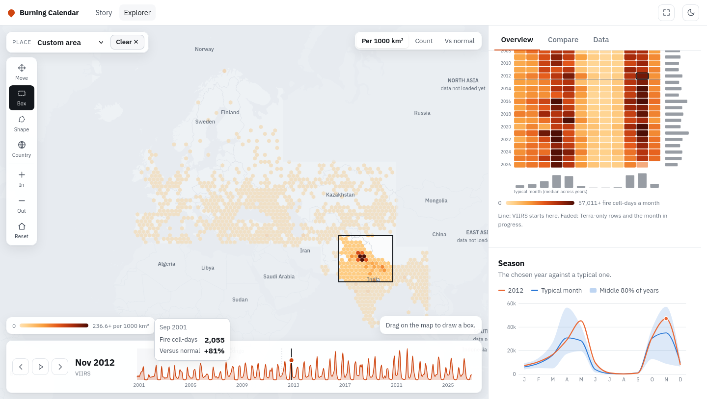 |

| Anomaly against a normal month | Calendar as anomaly |
|---|---|
| 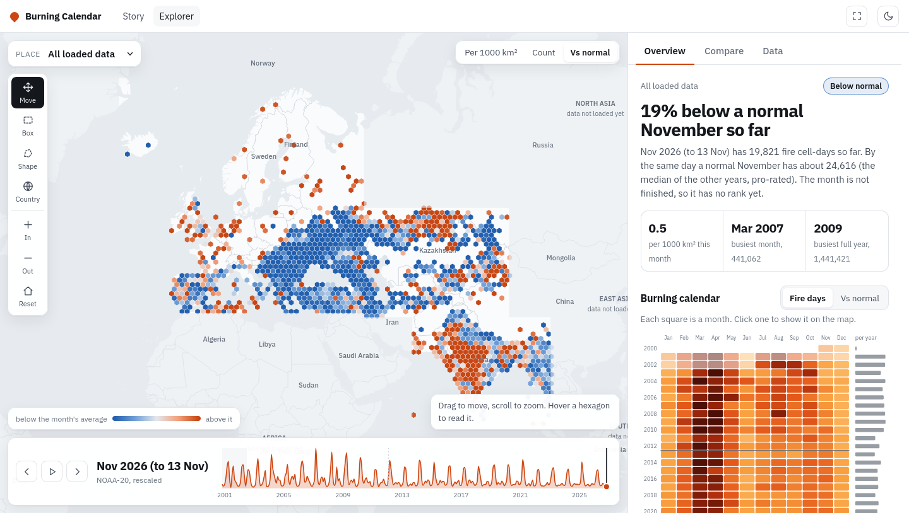 | 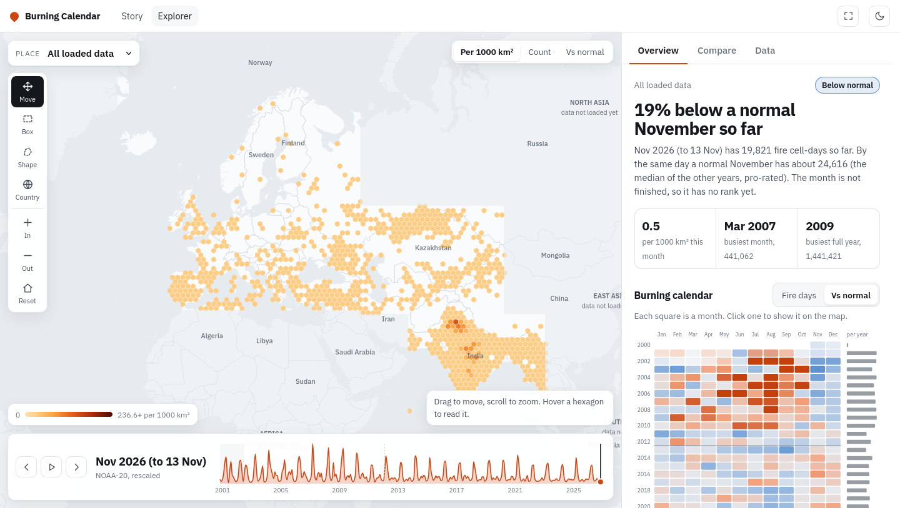 |

| Compare two places or times | Data tab and coverage |
|---|---|
| 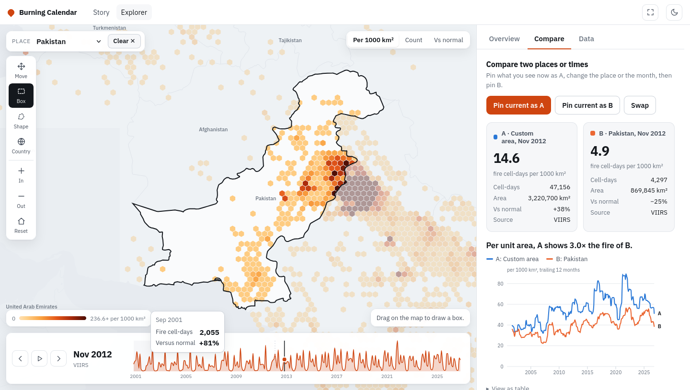 | 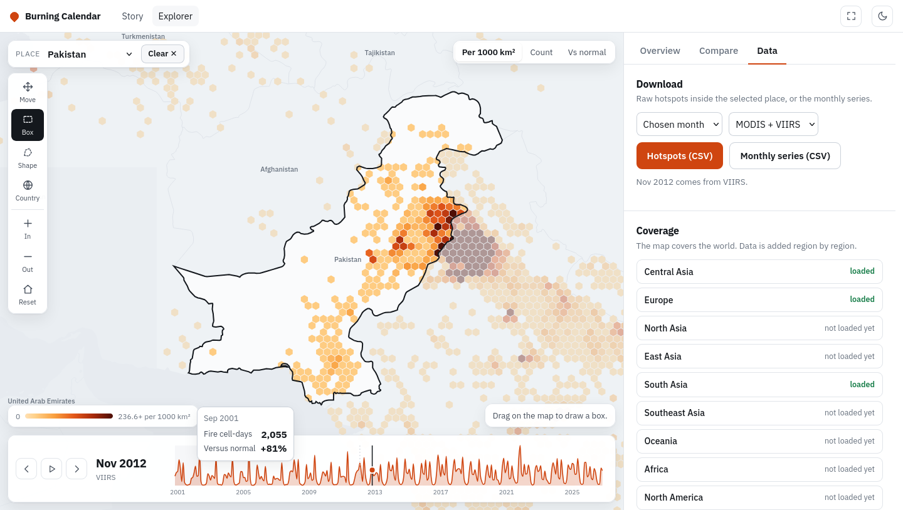 |

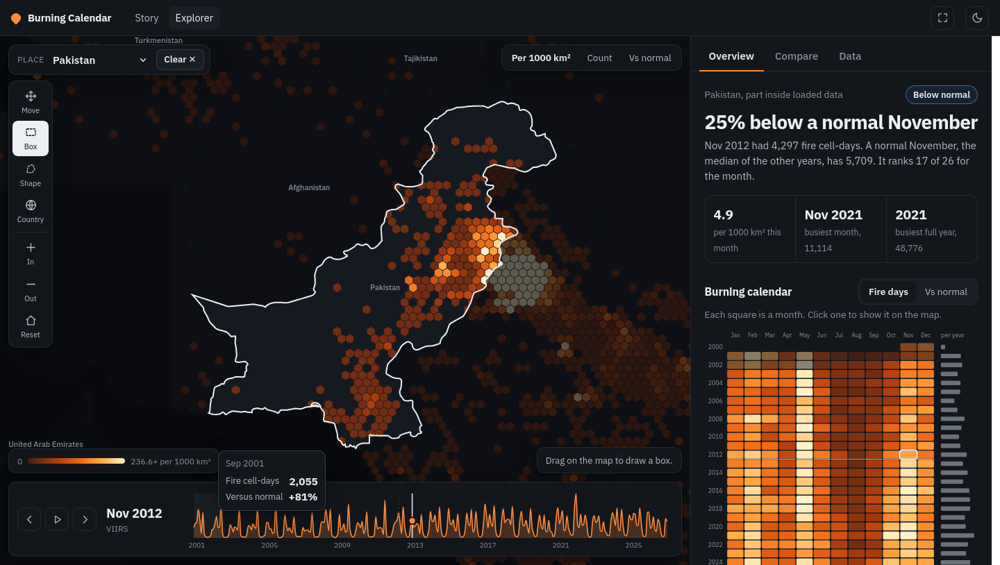

## Pipeline, end to end

```
NASA FIRMS API (MAP_KEY)
   │  01_world.py / 01_ingest.py   5-day windows, resumable, gzip, disk guard, one region at a time
   ▼
data/raw/<SOURCE>/<region>/<year>/*.csv.gz       MODIS_SP, VIIRS_SNPP_SP, VIIRS_NOAA20/21_SP, *_NRT
   │  02_clean.py      vegetation fires only, confidence floor, static-source mask for NRT, 0.01° cell and 0.25° tile ids
   ▼
data/clean/points_<year>.pkl                     (also served by the CSV endpoint)
   │  03_aggregate.py  dedupe to unique 1 km cell-days, count per tile x month x sensor
   ▼
data/agg/tile_month.pkl.xz
   │  04_calibrate.py  fit MODIS -> VIIRS-SNPP and NOAA-20/21 -> SNPP, compare 3 models on held-out months
   │  05_harmonize.py  one series per tile and month, in VIIRS-equivalent cell-days
   ▼
data/agg/harmonized.npz, calibration_metrics.json
   │  06_export.py     matrix.bin (tiles x months, fixed point), meta.json, series.json
   │  07_countries.py  country membership of every tile (Natural Earth), boundaries for the CSV endpoint
   ▼
web/data/*   ──►  static site (D3, canvas hex map)    +   api/server.py (only for raw-hotspot CSV)
```

### Method in short
1. **Download.** FIRMS standard-processing archives for the long record (MODIS 2000-, SNPP 2012-, NOAA-20 2018-,
   NOAA-21 2023-), and near-real-time files for the months the archive has not reached yet.
2. **Clean.** Keep vegetation fires (`type = 0`) above the confidence floor (MODIS >= 30, VIIRS nominal/high).
   NRT files carry no type flag, so cells that the standard archive marks as static sources (gas flares,
   industry) are masked in NRT. Without this mask, recent months were inflated by 60-100%.
3. **One counting unit.** A unique **1 km cell with fire on a given day**, per sensor family. VIIRS 375 m pixels that fall into
   one 1 km cell the same day count once. This is what makes the two sensors comparable at all.
4. **Calibrate.** On the overlap 2012-02..2018-12, MODIS (Terra + Aqua) is fitted to VIIRS SNPP per calendar month.
   Three models are tried (pooled ratio, shrunk per-tile ratio, log-log); the one with the lowest error on 2019-2026 months
   that were **held out** is kept. Terra-only months (2000-11..2002-06) are first scaled to Terra + Aqua.
5. **Continue past SNPP.** NOAA-20 and NOAA-21 are calibrated against SNPP the same way, so the series continues
   when SNPP data stops. The running month is shown as partial and compared with a pro-rated normal.
6. **Precompute everything.** The site reads a 24 MB uint16 matrix and small JSON files, no database and no tile server.

### Results (held-out months, region totals)
| Model | R² | Typical monthly error (MAPE) | Bias |
|---|---|---|---|
| MODIS raw | -0.22 | 70.6% | -71.8% |
| **MODIS rescaled (shrunk tile ratio)** | **0.97** | **9.7%** | **-0.9%** |
| NOAA-20 -> SNPP | 0.99 | 6.2% | +3.7% |
| NOAA-21 -> SNPP | 0.97 | 5.9% | +5.0% |

Full numbers: `data/agg/calibration_metrics.json`. Tile-level correlation of rescaled MODIS with VIIRS is 0.92.

## Run it
Site only (data is in the repo, nothing to download):

    python3 api/server.py            # http://localhost:8000   (story) and /explore.html (explorer)

or with Docker:

    docker compose up -d --build     # http://localhost:8000

Rebuild the derived data from what is committed (works right after `git clone`):

    python3 pipeline/04_calibrate.py && python3 pipeline/05_harmonize.py \
      && python3 pipeline/06_export.py && python3 pipeline/07_countries.py
    # or: docker compose --profile pipeline run --rm pipeline

Rebuild everything from NASA (needs a free FIRMS MAP_KEY in `.env` as `FIRMS_MAP_KEY=...`, about 1.6 GB of downloads):

    python3 pipeline/01_world.py [region ...]     # resumable; pipeline/world_forever.sh keeps it going unattended
    python3 pipeline/02_clean.py && python3 pipeline/03_aggregate.py
    python3 pipeline/04_calibrate.py ... 07_countries.py

Needs Python 3 with **pandas and numpy only**. The front end is plain JS + D3, no build step.

## Data in this repository
Committed: `web/data/`, `data/agg/` (tile x month counts as `.pkl.xz`, calibration, harmonized series) and
`data/boundaries/`. Not committed (too big for GitHub): `data/raw/` (1.6 GB) and `data/clean/` (2 GB). Without `data/clean/`
everything works except the raw-hotspot CSV download, which returns nothing.

## Coverage and honest limits
- **Loaded now:** Central Asia, Europe, South Asia (about 39,000 burning 0.25° tiles, 116 countries). The map and pipeline are
  world-wide; the other seven boxes in `pipeline/regions.py` are download-and-run (`01_world.py`), the site picks them up automatically.
- Months 2000-11..2002-06 rest on Terra only and are the least certain. 2002-07..2012-01 are MODIS rescaled; from 2012-02 VIIRS SNPP is used as measured.
- Hotspot counts measure satellite-detected burning, not burned area or fire size. Cloud, overpass time and detection limits still apply.
- NOAA-21 is calibrated on a short window (2023-03..2025-03).
- A static host (GitHub Pages) serves everything except the raw-hotspot CSV, which needs `api/server.py`.

## Repository layout
    pipeline/   01-07 scripts, regions.py, harmonize_lib.py
    api/        server.py: static files (gzip) + /api/points.csv
    web/        index.html (story), explore.html (explorer), js/, css/, vendor/, data/ (precomputed)
    data/agg/   tile x month counts, calibration, harmonized series (committed)
    docs/       demo video, GIF, screenshots

## Credits
Hotspots: NASA FIRMS (MODIS Collection 6.1, VIIRS 375 m). Boundaries: Natural Earth via world-atlas. Basemap and charts: D3.
Built by Muhammadjon Aslonov for the 2026 NASA Space Apps Challenge.
